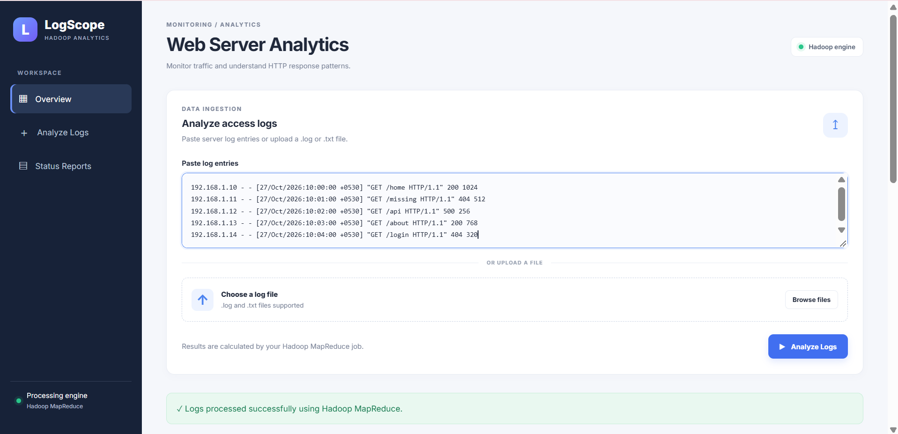
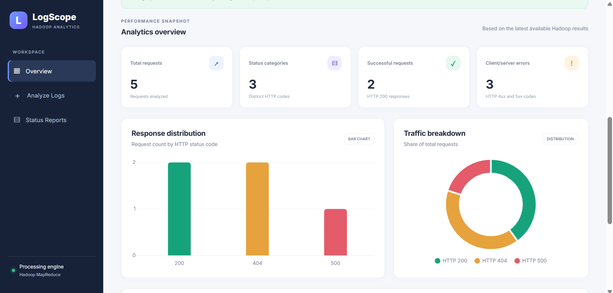
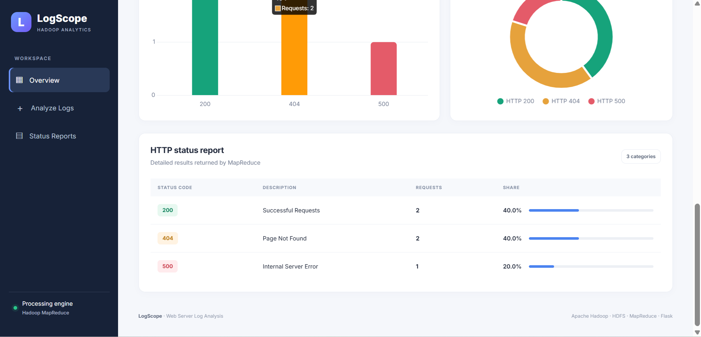

# LogScope | Hadoop Analytics

LogScope is a web-based Hadoop log analysis application that processes web server logs using Apache Hadoop MapReduce and presents the results through an interactive dashboard. It helps users understand HTTP request patterns, identify errors, and visualize server response statistics.

## Features

- Upload `.log` and `.txt` files for analysis.
- Process web server logs using Hadoop MapReduce.
- Store input and output data using HDFS.
- Display total requests and HTTP status code statistics.
- Visualize request counts using interactive charts.
- Display status code descriptions, counts, and percentages.
- Handle empty input, invalid file types, and Hadoop processing failures.

## Technologies Used

- **Backend:** Python, Flask
- **Frontend:** HTML, CSS, JavaScript
- **Data Processing:** Apache Hadoop MapReduce
- **Programming Language for MapReduce:** Java
- **Storage:** Hadoop Distributed File System (HDFS)
- **Charts:** Chart.js
- **Development Environment:** Ubuntu on WSL

## Project Architecture

```text
User
  |
  v
LogScope Web Dashboard
  |
  v
Flask Backend
  |
  v
Log File Input
  |
  v
HDFS Input Directory
  |
  v
Hadoop MapReduce
  |
  v
HDFS Output Directory
  |
  v
Flask Reads Results
  |
  v
Dashboard Statistics and Charts
```

## Project Structure

```text
loganalysis/
├── app.py
├── LogAnalysis.java
├── README.md
├── access.log
├── loganalysis.jar
├── templates/
│   └── index.html
├── static/
│   └── style.css
└── screenshots/
    ├── dashboard1.png
    ├── dashboard2.png
    └── dashboard3.png
```

*Note: Some files, such as the JAR and sample log, may be excluded from Git by `.gitignore`.*

## Prerequisites

Install and configure the following:

- Java 17
- Apache Hadoop 3.4.2
- Python 3
- pip
- Ubuntu or a compatible Linux environment

Verify the installations:

```bash
java -version
hadoop version
python3 --version
```

## Installation and Setup

### 1. Clone the Repository

```bash
git clone https://github.com/SudhikshaBA1737/Hadoop-Log-Analysis.git
cd Hadoop-Log-Analysis
```

### 2. Configure Hadoop

Ensure Hadoop is configured correctly and its commands are accessible from your terminal.

Start HDFS:

```bash
start-dfs.sh
```

If your configuration requires YARN, start it as well:

```bash
start-yarn.sh
```

Check the running Java processes:

```bash
jps
```

### 3. Set Up the Python Environment

```bash
python3 -m venv venv
source venv/bin/activate
pip install flask
```

### 4. Compile the MapReduce Program

From the project directory:

```bash
mkdir -p build
javac -classpath "$(hadoop classpath)" -d build LogAnalysis.java
jar -cvf loganalysis.jar -C build .
```

These commands assume `LogAnalysis.java` has no package declaration and the main class is named `LogAnalysis`.

### 5. Prepare HDFS

Create the input directory:

```bash
hdfs dfs -mkdir -p /user/sudhi/loganalysis/input
```

Make sure the HDFS paths and username configured in `app.py` match your environment.

## Running the Application

### 1. Start the Flask Backend

```bash
cd ~/loganalysis
source venv/bin/activate
python app.py
```

### 2. Open the Dashboard

Open your browser and visit:

http://localhost:5000

### 3. Analyze Log Files

1. Upload a `.log` or `.txt` file, or paste log entries into the input box.
2. Click **Analyze Logs**.
3. Flask transfers the input to HDFS.
4. Hadoop MapReduce processes the logs and generates output.
5. Flask reads the output and displays the updated statistics and charts.

The Hadoop services and compiled JAR must be available for analysis to work.

## Sample Input

```text
127.0.0.1 - - [27/Oct/2026:10:00:00 +0000] "GET / HTTP/1.1" 200 123
127.0.0.1 - - [27/Oct/2026:10:01:00 +0000] "GET /missing HTTP/1.1" 404 100
127.0.0.1 - - [27/Oct/2026:10:02:00 +0000] "GET /error HTTP/1.1" 500 50
```

## Sample Output

```text
200     1
404     1
500     1
```

The dashboard displays the total number of requests, status code categories, request counts, percentages, and visual charts.

## Error Handling

The application handles several error scenarios:

- Unsupported file types
- Empty input submissions
- Hadoop MapReduce execution failures
- Errors when reading Hadoop output

Error messages are displayed on the dashboard when a problem occurs.

## Dashboard Screenshots

### 1. Main Dashboard



### 2. Dashboard Statistics and Charts



### 3. Log Analysis Results



## Future Enhancements

- Add filtering by date, HTTP status code, and endpoint.
- Support downloadable analysis reports.
- Add user authentication and access controls.
- Deploy the application to a server environment.
